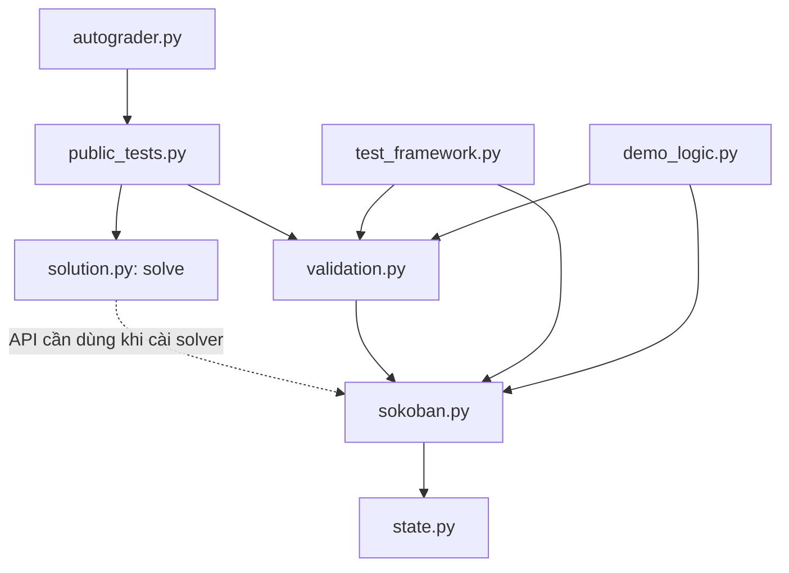

# Sokoban — hướng dẫn chi tiết, bản làm lại

## 1. Bắt đầu từ đây

Đây là bản **chú thích tiếng Việt của bộ bài tập bạn đã gửi**. File trên Drive
là PDF chứa mã Python; bộ này khôi phục thành .py, sửa ngắt dòng/thụt đầu dòng
do PDF và thêm giải thích. Luật chơi và dữ liệu 20 bàn được giữ theo nguồn.

**solution.py gốc chưa có thuật toán:** solve() luôn ném NotImplementedError.
Bản này giữ nguyên phần bài tập đó. Bạn chạy được kiểm tra framework và demo
ngay, nhưng chưa tự động giải các bàn cho tới khi tự cài solve().
Chương trình chạy trong terminal; không có cửa sổ game điều khiển bằng phím.

| File | Vai trò |
| --- | --- |
| state.py | Lớp cha StateSpace: nút tìm kiếm, chi phí, cha, in đường đi |
| sokoban.py | SokobanState, Direction, luật di chuyển, kiểm tra đích, 20 bàn |
| solution.py | Hàm solve cần sinh viên triển khai |
| validation.py | Chữ ký cấu hình và kiểm tra đường đi hợp lệ |
| test_framework.py | Lớp FrameworkTests với 7 kiểm tra luật chơi |
| public_tests.py | Lớp PublicTests với 3 kiểm tra giao diện solver |
| autograder.py | Chạy từng public test độc lập, tùy chọn ghi JSON |
| demo_logic.py | Ví dụ bổ sung để xem một lần đẩy, không cần solver |
| nguon_pdf/ | 8 PDF nguồn để đối chiếu |
| NGUON_VA_KIEM_TRA.md | Nguồn khôi phục, thay đổi và kết quả kiểm tra |

Tên PDF public_test.pdf được chuyển thành **public_tests.py (có chữ s)**,
đúng tên mà README gốc và autograder sử dụng. Tài liệu báo cáo/ODT trong Drive
không phải module Python nên không được tạo thành class trong gói này.

## 2. Cài đặt và chạy

1. Cài Python 3.10 trở lên theo yêu cầu đề.
2. Giải nén ZIP, mở thư mục Sokoban_GiaiThich_ChiTiet chứa các file .py.
3. Mở terminal tại thư mục này. Trong VS Code: Open Folder rồi Terminal → New Terminal.
4. Không cần cài gói bằng pip: tất cả dùng thư viện chuẩn Python.

Windows — chạy lần lượt:

    py --version
    py demo_logic.py
    py -m unittest test_framework -v

macOS/Linux — chạy lần lượt:

    python3 --version
    python3 demo_logic.py
    python3 -m unittest test_framework -v

Các lệnh bên dưới dùng python; thay bằng py hoặc python3 theo máy bạn.

**Kết quả mong đợi:**

- Demo in nút START rồi nút sau bước 0 right; đạt đích True, số bước 1.
- Parent đúng True; đầu vào giữ nguyên True; kiểm tra True Valid solution.
- Bộ test_framework chạy 7 test, kết thúc bằng OK.
- Autograder hiện báo 3 FAIL vì solve chưa cài. Đây là trạng thái bài tập gốc.

Sau khi tự viết solve:

    python -m unittest public_tests -v
    python autograder.py
    python autograder.py --test test_one_box
    python autograder.py --json ket_qua.json

--test chọn một tên hàm kiểm tra. --json ghi báo cáo ra file.
Chạy riêng python solution.py không giải bàn nào vì file chỉ khai báo hàm.
Public test chỉ là phản hồi cơ bản, không phải điểm chính thức hay bảo đảm
vượt qua tập test ẩn.

## 3. Luật và tọa độ

Mỗi hành động chọn **một robot đi một ô** lên, phải, xuống hoặc trái.
Robot không ra ngoài, không xuyên tường hoặc robot khác. Nếu ô kế tiếp có
thùng thì chỉ đẩy được khi ô ngay sau thùng trống và trong bàn.
Không kéo thùng, không đẩy hai thùng một lượt.

Mọi bước đều giá 1, kể cả đi bộ. Mục tiêu là mọi thùng thuộc tập ô đích;
có thể còn dư ô đích và robot đứng đâu cũng được.

Tọa độ (x,y) có x tăng sang phải, y tăng xuống dưới, bắt đầu từ 0.
Bàn rộng 4, cao 3 có 0 <= x < 4 và 0 <= y < 3.
Viền tường thêm lúc in không làm tăng width/height của mô hình.

| Ký tự | Nghĩa |
| --- | --- |
| Khoảng trắng | Ô trống |
| # | Vật cản hoặc viền |
| . | Ô đích |
| $ | Thùng chưa ở đích |
| * | Thùng trên đích |
| a, b, … | Robot 0, 1, … |
| A, B, … | Robot tương ứng đang trên ô đích |

## 4. StateSpace và các thuộc tính kế thừa

Class là khuôn mẫu; đối tượng là một lần tạo cụ thể. Mỗi SokobanState biểu diễn
một cấu hình bàn tại một thời điểm, kèm đường đi đã tới nó.

| Thuộc tính | Ý nghĩa |
| --- | --- |
| StateSpace.n | Bộ đếm thuộc lớp, tăng mỗi lần tạo nút trong tiến trình |
| action | Hành động từ cha tới nút này, ví dụ "0 right" |
| gval | Tổng chi phí từ đầu, gồm đi bộ và đẩy |
| parent | Tham chiếu tới nút trước; nút đầu dùng None |
| index | Mã lần tạo đối tượng, không phải khóa cấu hình hoặc số bước |

Hàm __init__ gán dữ liệu. successors, hashable_state, print_state ở lớp cha
chưa cài nên ném NotImplementedError. SokobanState ghi đè các hàm đó.
print_path được cài trong lớp cha và lớp con dùng lại.

Import sokoban đã tạo 20 nút PROBLEMS, vì thế nút demo không nhất thiết có
index=0. Validator cũng sinh nút tạm làm bộ đếm tăng. Không dùng index làm visited.

## 5. SokobanState và Direction

SokobanState gọi constructor lớp cha rồi lưu thêm dữ liệu bàn:

| Thuộc tính | Kiểu theo đề | Ý nghĩa |
| --- | --- | --- |
| width, height | int | Kích thước cố định |
| robots | tuple các tọa độ | Có thứ tự, vị trí thứ i là robot i |
| boxes | frozenset tọa độ | Vị trí thùng, không phân biệt danh tính |
| storage | frozenset tọa độ | Ô đích cố định |
| obstacles | frozenset tọa độ | Vật cản cố định |

Constructor không tự xác minh tọa độ hay va chạm; đề cung cấp đầu vào hợp lệ.
Tuple/frozenset không cho thêm xóa phần tử trực tiếp. Tuy nhiên đối tượng
SokobanState vẫn cho gán lại thuộc tính, nên solver phải chủ động không sửa đầu vào.

Direction là lớp độc lập, lưu name và delta=(dx,dy). move(location) cộng tọa độ,
không kiểm tra biên/tường. __str__ và __repr__ trả tên để hiển thị;
__hash__ băm tên. Không có __eq__ riêng, nên hai đối tượng cùng tên không
tự được coi là bằng nhau. Không sửa name khi đã dùng đối tượng làm khóa.

| Hằng | name | delta |
| --- | --- | --- |
| UP | up | (0,-1) |
| RIGHT | right | (1,0) |
| DOWN | down | (0,1) |
| LEFT | left | (-1,0) |

## 6. Theo dõi successors từng bước

Demo có robot (0,1), thùng (1,1), đích (2,1). Khi xét hướng phải:

1. Direction.move tính ô robot muốn tới là (1,1).
2. Kiểm tra ô đó trong bàn, không là vật cản hoặc robot khác.
3. Thấy có thùng, tính tiếp ô sau thùng là (2,1).
4. Kiểm tra ô sau cũng hợp lệ và không có thùng khác.
5. Sao chép boxes, xóa (1,1), thêm (2,1).
6. Sao chép robots, chuyển robot 0 tới (1,1).
7. Tạo nút mới: action="0 right", gval=1, parent=initial.
8. Thêm vào danh sách kết quả, rồi tiếp tục thử các hướng còn lại.

new_robots tạm loại robot đang đi để kiểm tra robot khác; trước khi tạo nút,
code lấy lại đầy đủ danh sách và thay đúng chỉ số. new_boxes là set để chỉnh
bản sao, rồi đóng lại thành frozenset khi lưu.

Một hướng sai dùng continue để bỏ qua. successors trả **mọi nút kế hợp lệ**,
không chọn nút tốt nhất và không tìm nhiều bước tới đích. Việc chọn do solve làm.
Hàm không loại mọi thế bí: đẩy thùng vào góc không phải đích có thể hợp lệ nhưng
khiến bài toán không còn giải được.

## 7. Các hàm hiển thị và ba khái niệm dễ nhầm

state_string dựng ma trận ký tự bằng map[y][x], vẽ đích, vật cản, robot, thùng,
thêm viền rồi trả chuỗi có xuống dòng. Nó không tự in.
print_state in action và chuỗi bàn. print_path lần parent và in toàn đường.

**Khóa cấu hình và chữ ký đầy đủ:** hashable_state trả (robots,boxes), dùng
trong cùng map để phát hiện trạng thái đã gặp. Không chứa gval/parent/index,
vì cùng cấu hình có thể đến từ nhiều đường. Không dùng chung visited giữa các
map khác nhau. signature trong validation chứa cả kích thước, đích và vật cản;
public test còn so sánh action/gval/parent riêng.

**Đạt đích và lời giải hợp lệ:** sokoban_goal_state chỉ kiểm tra mỗi thùng có
thuộc storage hay không. Tự tạo một nút có thùng ở đích không chứng minh được
đường đi. Validator còn kiểm tra các bước từ đầu.

**Chi phí và số nút:** gval tăng theo đường đi; index/n tăng theo số lần tạo
đối tượng, kể cả nút bỏ đi và nút sinh khi xác minh.

## 8. Parent và validation

Nút cuối trỏ về nút trước, lần lượt tới nút đầu có parent=None.
print_path thu danh sách theo chiều ngược rồi reversed để in đúng thứ tự.
Nó gọi print_state của lớp con. Không gọi trên chuỗi cha có vòng vì không tự chặn vòng.

validate_solution(initial,final) thực hiện:

1. final phải là SokobanState.
2. Lần ngược cha, chặn sai kiểu hoặc lặp id đối tượng.
3. Đảo chain về thứ tự đầu-cuối.
4. Chữ ký và gval của nút đầu phải khớp initial.
5. Mỗi cặp nút phải tăng gval đúng 1.
6. Sinh lại successors của nút trước: phải có action và chữ ký khớp nút sau.
7. Nút cuối phải đạt đích.

Hàm trả (bool, thông báo), ví dụ (True, "Valid solution").
chain là các nút đã gom; seen là id đã gặp; previous/following là hai nút kề.
Validator không bắt nút đầu phải cùng đối tượng với initial, chỉ cần khớp dữ liệu
được kiểm tra. Nó kiểm tra đường đi, không chấm tối ưu.

## 9. Các file phối hợp

| Điểm chạy | Luồng gọi |
| --- | --- |
| demo_logic.main | Tạo SokobanState → successors → print_path → validation |
| unittest test_framework | Gọi FrameworkTests → sokoban và validation, không gọi solver |
| unittest public_tests | Tạo bàn → solution.solve → kiểm tra đầu vào và validation |
| autograder.main | Đọc AST public_tests → chọn tên test → chạy unittest từng tiến trình |
| solve sau khi bạn cài | Chọn nút → kiểm tra đích → sinh con → quản lý tránh lặp → trả nút cuối |

SokobanState kế thừa StateSpace. FrameworkTests và PublicTests kế thừa
unittest.TestCase, dùng các assert có sẵn và không khai báo thuộc tính riêng.
Direction là lớp hỗ trợ độc lập. start, before, chain, results… là biến cục bộ,
không phải thuộc tính class.

## 10. Ý nghĩa từng test và bộ chạy

| Hàm test | Nội dung |
| --- | --- |
| test_push_and_cost | Đẩy đúng, giá 1, parent đúng, đầu vào giữ nguyên, validator chấp nhận |
| test_no_double_push | Không đẩy hai thùng liền nhau |
| test_robot_blocks_push | Không đẩy vào robot khác |
| test_obstacle_blocks_push | Không đẩy vào vật cản |
| test_multiple_robots_move_one_at_a_time | Chỉ một robot đổi vị trí mỗi bước |
| test_state_key_and_storage | Khóa tuple, dư ô đích vẫn thắng, có 20 bàn |
| test_validator_rejects_forgery | Loại nút đích giả, hành động sai, vòng cha |
| test_one_box | Solver giải bàn nhỏ, không sửa đầu vào |
| test_initial_goal | Xử lý bàn đã là đích từ đầu |
| test_zero_budget | Bàn chưa giải với 0 giây phải trả đúng False, không phải None/0 |

board trong test_framework và simple_state trong public_tests tạo bàn nhỏ.
board cho thay robots/boxes/storage/obstacles. simple_state(solved=True) đặt
thùng ngay trên đích, còn False đặt thùng trước đích một ô.

Autograder đọc cây AST để tìm tên hàm bắt đầu test_ trong PublicTests, tránh
import bài làm ngay trong tiến trình điều phối. Nó gọi từng test bằng chính
Python đang dùng, với giới hạn cứng 120 giây. status là PASS/FAIL/TIMEOUT,
detail chứa stdout/stderr, results là danh sách, payload là báo cáo JSON.
Mã thoát là 0 nếu tất cả đạt, ngược lại 1.

## 11. Tự triển khai solve

Giữ chữ ký solve(initial_state, timebound=120). initial_state hợp lệ có
gval=0, parent=None; timebound là số giây, không phải số bước.
Trả nút đích có chuỗi cha hợp lệ, hoặc đúng False khi chưa tìm được.
Không sửa initial_state. Bàn đã giải có thể trả chính initial_state.
Bàn chưa giải với ngân sách 0 phải trả False.

Cần quản lý tập nút chờ, khóa cấu hình đã gặp/chi phí tốt nhất, thời gian còn lại,
điều kiện hết nút hoặc đạt đích. Gọi successors để lấy các bước đúng luật.
Theo dõi timebound trong solver; giới hạn subprocess của autograder không
thay thế trách nhiệm này.

Bạn có thể học BFS trước: lấy nút theo thứ tự vào hàng đợi và tránh lặp.
Vì mỗi bước giá 1, BFS tìm lời giải ít bước nhất nếu hoàn tất tìm kiếm,
nhưng có thể tốn rất nhiều bộ nhớ/thời gian. Đề cho tự chọn thuật toán và heuristic.
Gói này không cài BFS hay áp đặt cách giải.

Sau khi cài solve, thử trong Python từ thư mục dự án:

    from sokoban import PROBLEMS
    from solution import solve
    from validation import validate_solution
    initial = PROBLEMS[1]
    final = solve(initial, timebound=5)
    if final is False:
        print("Chưa tìm được lời giải trong giới hạn.")
    else:
        valid, message = validate_solution(initial, final)
        print(valid, message)
        if valid:
            print(final.gval)
            final.print_path()

PROBLEMS[1] là bàn thứ hai, chỉ số hợp lệ 0..19. Không bảo đảm thuật toán bất kỳ
giải xong trong 5 giây. Trước khi viết solve, ví dụ trên vẫn báo NotImplementedError.

## 12. Lỗi thường gặp và thứ tự học

| Hiện tượng | Cách hiểu / xử lý |
| --- | --- |
| Không nhận python | Thử py hoặc python3, kiểm tra cài Python |
| Can't open file | Mở terminal tại thư mục chứa file đã giải nén |
| No module named sokoban | Để các file .py cùng thư mục, chạy đúng thư mục |
| Implement your Sokoban solver | solve còn là khung gốc, cần viết thuật toán |
| Expected a SokobanState solution | Trả sai kiểu hoặc chưa có lời giải |
| Incorrect path cost | gval không tăng đúng 1 |
| Illegal transition | Bước đi hoặc action không khớp luật |
| Invalid or cyclic parent chain | Cha sai kiểu hoặc chuỗi cha có vòng |
| TIMEOUT | Test vượt giới hạn cứng; kiểm tra thuật toán và điều kiện dừng |

Thứ tự học: state.py → Direction và SokobanState → chạy demo →
validation.py → test_framework.py → public_tests.py → autograder.py → viết solve.
Mỗi class/hàm đều có chú thích ngay trong file để đối chiếu.

Theo đề gốc, chỉ nộp solution.py sau khi hoàn thiện. Chỉ dùng thư viện chuẩn
và framework; không đổi luật, không viết cứng theo test, không đọc dữ liệu bộ chấm,
không truy cập mạng hoặc tạo tiến trình/luồng nền trong bài giải. Mỗi test chấm
chạy mới, không dựa vào dữ liệu lưu giữa các test. Subprocess trong autograder
là việc của bộ kiểm tra, không phải mẫu để đưa vào solution.

## 13. Sơ đồ quan hệ giữa các file

Sơ đồ thể hiện quan hệ gọi/import, không có nghĩa tất cả được chạy cùng lúc.

Nếu trình đọc Markdown không hiện sơ đồ, xem bảng ở mục 9. Mũi tên nét đứt
là quan hệ cần thiết khi triển khai solver; khung solution hiện chưa import sokoban.

## 14. Bảng diễn tiến cụ thể của một lần đẩy

| Thời điểm | robots | boxes | action | gval | parent |
| --- | --- | --- | --- | --- | --- |
| Nút đầu | ((0,1),) | {(1,1)} | START | 0 | None |
| Xét thử hướng phải | Chưa đổi | Chưa đổi | Chưa tạo nút | Chưa đổi | Chưa đổi |
| Nút con được tạo | ((1,1),) | {(2,1)} | 0 right | 1 | Nút đầu |
| Sau khi gọi validator | Như nút con | Như nút con | 0 right | 1 | Nút đầu |

Trong bảng, dấu ngoặc nhọn chỉ cách viết ngắn gọn tập tọa độ; mã lưu boxes bằng
frozenset. storage luôn là {(2,1)}, obstacles rỗng, width=4 và height=3.
Nút đầu vẫn giữ nguyên dữ liệu cũ sau khi nút con xuất hiện.

Ở test_one_box, validator nhận một nút đầu mới do simple_state() tạo lại.
Điều này vẫn hợp lệ vì validator đối chiếu chữ ký và gval, không buộc cùng id.
Ngược lại, test_push_and_cost dùng assertIs(goal.parent,start) để kiểm tra riêng
rằng successors thực sự nối parent về đúng đối tượng đã sinh ra nó.

## 15. Những cú pháp cần biết để đọc mã

| Cú pháp | Cách hiểu trong bài này |
| --- | --- |
| self | Đối tượng hiện tại; self.boxes là thùng của trạng thái đang xét |
| __init__ | Hàm khởi tạo thuộc tính, không phải hàm giải bài toán |
| super/lời gọi StateSpace.__init__ | Khởi tạo phần thông tin kế thừa từ lớp cha |
| None | Không có nút cha ở đầu đường đi |
| is | So sánh có cùng đối tượng; khác == là so sánh giá trị |
| id(obj) | Định danh đối tượng trong lúc nó còn tồn tại, dùng phát hiện vòng cha |
| frozenset | Tập không sửa phần tử trực tiếp, không có thứ tự và dùng được trong khóa |
| tuple một phần tử | ((0,1),) phải có dấu phẩy; đây là danh sách một robot dạng tuple |
| enumerate | Lấy cả chỉ số và phần tử; chỉ số dùng làm tên robot |
| zip | Ghép từng cặp phần tử tương ứng từ hai dãy |
| next(... if ...) | Lấy phần tử đầu phù hợp, ví dụ nút có action 0 right |
| any(...) | True khi có ít nhất một ứng viên hợp lệ |
| list comprehension | Tạo danh sách bằng cách duyệt và có thể lọc phần tử |
| raise NotImplementedError | Chủ động báo phần chưa được cài đặt |
| if __name__ == '__main__' | Chạy khối lệnh khi mở file trực tiếp, không chạy khi import |
| assertTrue/assertEqual/assertIs | Kiểm tra đúng, bằng giá trị, cùng đối tượng trong unittest |

Chạy print_path khác với print_state: một hàm in cả chuỗi cha, một hàm chỉ in
một nút. Khi đọc mã, hãy luôn hỏi “biến này là một nút, một danh sách nút hay
một tập tọa độ?” để tránh nhầm đối tượng với dữ liệu nằm bên trong nó.

## 16. Tra cứu từng hàm và tình trạng bản làm lại

Mở [TRA_CUU_CLASS_VA_HAM.md](TRA_CUU_CLASS_VA_HAM.md) để xem toàn bộ 38 class/hàm,
chữ ký tham số, mô tả và số dòng chính xác trong từng file.
Các thuộc tính tự định nghĩa đã được chú thích trực tiếp tại nơi gán trong class.
Các lớp test sử dụng thuộc tính nội bộ kế thừa của unittest; bộ tài liệu không
sao chép toàn bộ mã thư viện chuẩn vào dự án.

Bản làm lại chuẩn hóa những dòng mã trước đây còn bị gãy khi lấy từ PDF;
chuyển mô tả class/hàm của các module kiểm tra thành docstring để xem được
bằng help(), đồng thời đặt chú thích ngay trước các bước xử lý quan trọng.
Đã so sánh cây cú pháp thực thi với bản khôi phục trước: không đổi luật hoặc
hành vi của tám file Python. Xem [KET_QUA_KIEM_TRA.txt](KET_QUA_KIEM_TRA.txt)
để biết kết quả chạy thực tế. Các kiểm tra này không chứng minh mọi lỗi có thể
có đều đã được loại bỏ và không thay thế bộ test ẩn.
